# Havantechno

Havantechno is a music program that takes a record apart and builds it again with its own instruments. You give it a
song; it separates the song into parts (drums, bass, the rest), guesses what made each sound, and sets up a project in
which its own drum machines, synths and sampler play those parts. You then edit, mix and export the result. It runs in
a web browser (Chrome or Edge) and as a desktop app built with Electron. It is written for the owner and a few friends,
not for sale. The code is in `app/`.

Five of its instruments also exist as **single pages** that play on their own in a browser, on a computer or a phone:
the HVT-303 bass line synth, the HVT-D mono synth, the HVT-106 poly synth, and the HVT-808 and HVT-909 drum machines.

**About sound.** Nobody has compared any of these instruments with a real unit, by ear or with a recording. Every
statement about sound in this repository is a measurement made by a program, or it is marked as unverified.

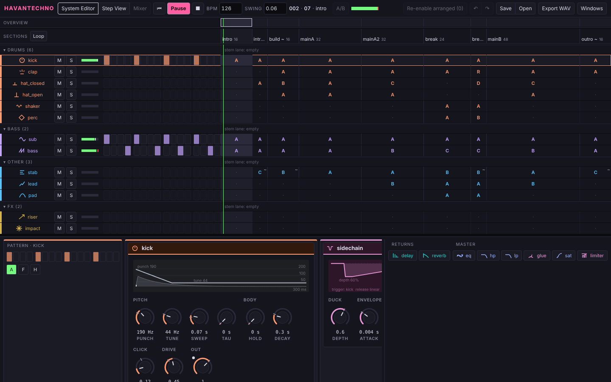

## Quick start

You need two things on your computer: **Git** and **Node.js** (the steps below were run on Node 22; any current LTS
release should do). Nothing else is installed for the browser version.

1. **Get the code, on the `main` branch.** The repository's default branch on GitHub is still an old one, so name `main`:

   ```bash
   git clone -b main https://github.com/CarlosFranzetti/Havantechno.git
   cd Havantechno
   ```

2. **Start the app's server** and leave that terminal open:

   ```bash
   node tools/serve.js
   ```

   It prints `App: http://localhost:8000/app/index.html`. If port 8000 is taken, run `node tools/serve.js 8080` and use that number below.

3. **Open <http://localhost:8000/app/> in Chrome** (or Edge). Click **Start audio** (browsers only make sound after a click), then **Play**. The Guidance recreation plays; click a section name in the ruler to jump.

4. **Try the instruments.** In the System Editor press **+ track** and pick "TR-808 kit", "TR-909 kit", "TR-909 kit (sampled)", "Bass line synth (HVT-303)", "Mono synth (HVT-D)" or "Poly synth (HVT-106)". Double-click the new track's device to open its panel in a floating window.

5. **Stop** with Ctrl+C in the terminal.

**The single instrument pages** run from the same server: open
<http://localhost:8000/app/solo/303.html>, `/app/solo/d.html`, `/app/solo/106.html`, `/app/solo/808.html` or
`/app/solo/909.html`. Tap the page once to start the sound.

**Desktop app.** From the repository folder: `cd app`, then `npm install` (downloads Electron, once), then `npm start`.
Installers are described under "Desktop builds" below.

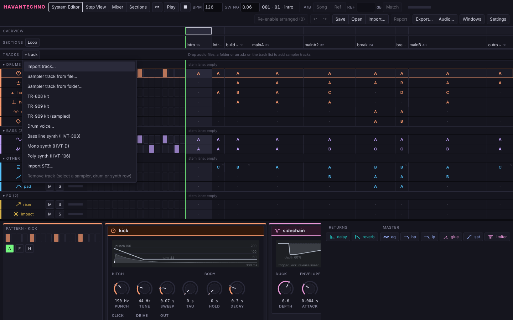

## The instrument pages

Each page is the real engine and the real panel from the app, with a step sequencer, presets and pattern save and load.
Published copies of all five exist as private pages that only the owner can open (links in `memory.md`); anyone with
this repository can run them locally as shown above.

- **HVT-303**: a bass line synth with sixteen steps of note, accent and slide.
- **HVT-D**: a three-oscillator mono synth with a 16 or 32-step sequencer (note, rest, tie, accent, glide, ratchet), a LOW / LAST note-priority switch (lowest note by default).
- **HVT-106**: a six-voice poly synth with chorus; a step can hold a chord of up to six notes.
- **HVT-808** and **HVT-909**: the drum machines worked like the hardware: pick a voice, tap the sixteen keys; eight pattern slots, each with an A and a B variation; A, B or A then B; accent row, mutes, clear, copy A to B; on the 909 also shuffle. Patterns 1 to 6 hold original grooves written for these pages.

On a phone the panels rearrange into a narrow layout.

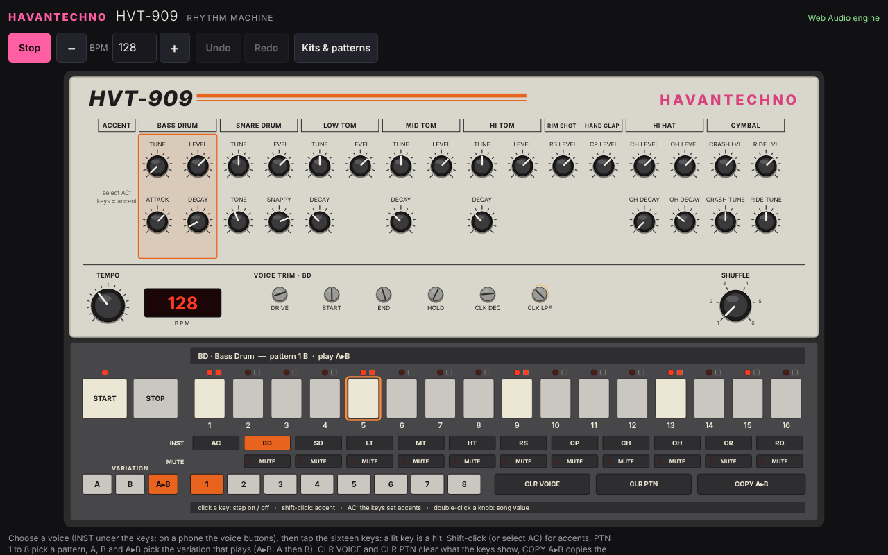

| | |
|---|---|
| 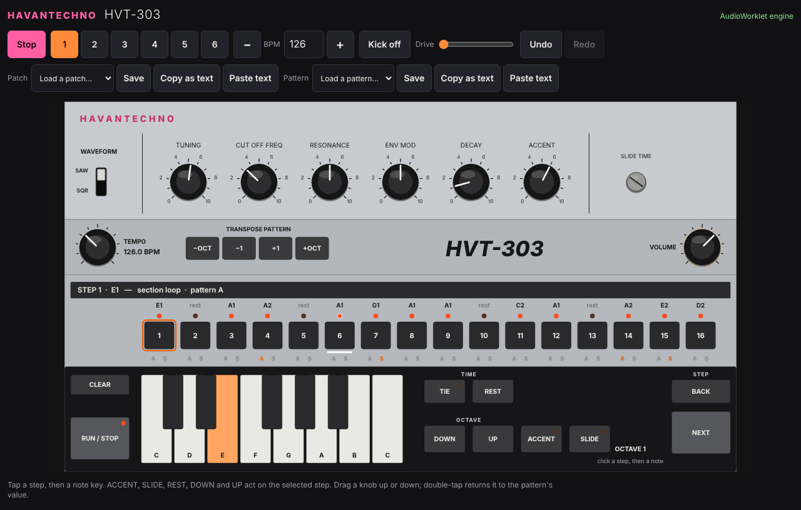 | 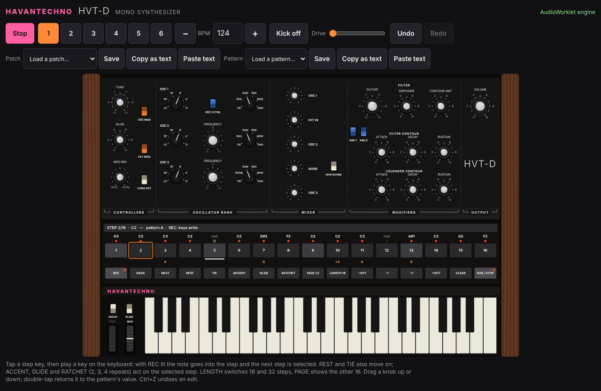 |
| 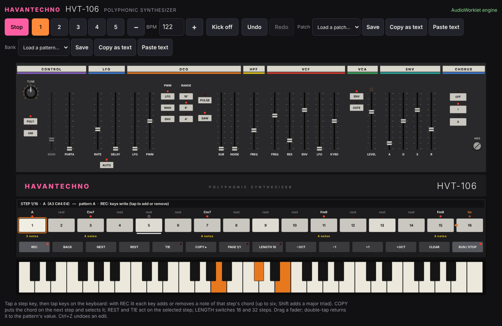 | 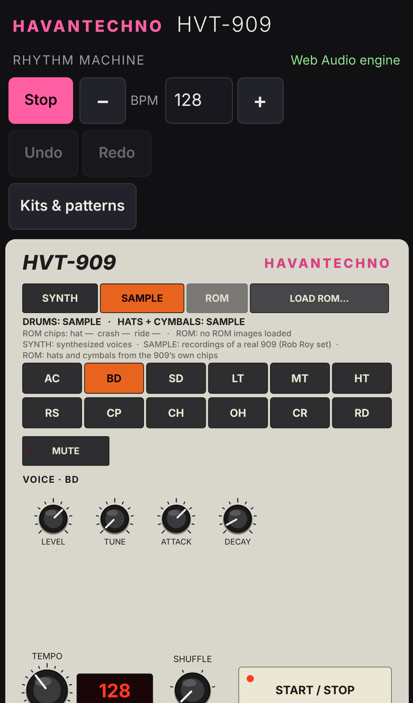 |

## A tour of the app

The view buttons at the top switch between four ways of looking at the same song. Tab switches within a pair (System
Editor and Step View, or Mixer and Sections); Ctrl/Cmd or Alt with 1 to 4 picks a view. Space plays and pauses,
Ctrl/Cmd+Z undoes, V hides or shows the device windows.

- **System Editor**: the song's sections along the top, one row per track with its pattern for the current section, and the selected track's chain of devices at the bottom. "+ track" adds instruments and samplers; double-click a device to open its window.
- **Step View**: every step of every track, with lanes for velocity, length, probability, nudge and parameter locks under the selected track.
- **Mixer**: one strip per track, grouped by family, with pan, sends, mute, solo, a fader and a meter; the effect returns and the master on the right.
- **Sections**: tracks down the side, the song's sections across the top; each cell is the pattern a track plays in that section. Changing a cell changes the song. The launch button on a section jumps there and loops it.

Each instrument opens in a **floating window** that shows a panel drawn after the hardware (Havantechno's mark and
model names only), or plain controls, or an editor. Settings decide which comes first.

| | |
|---|---|
| 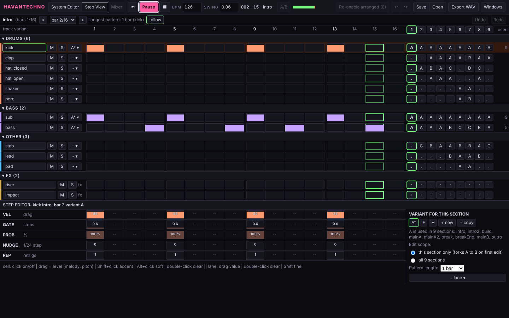 | 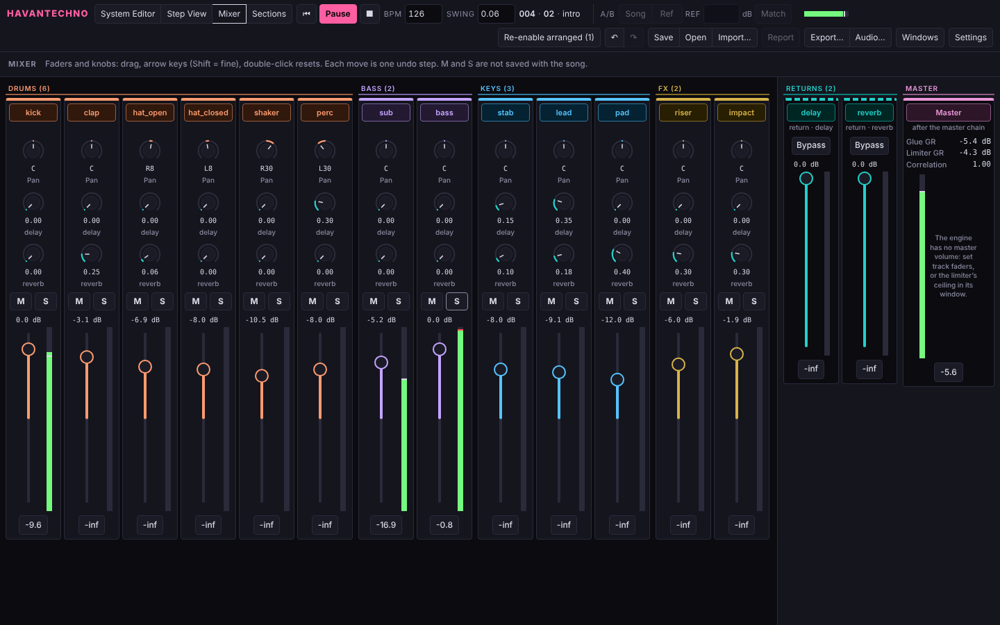 |
| 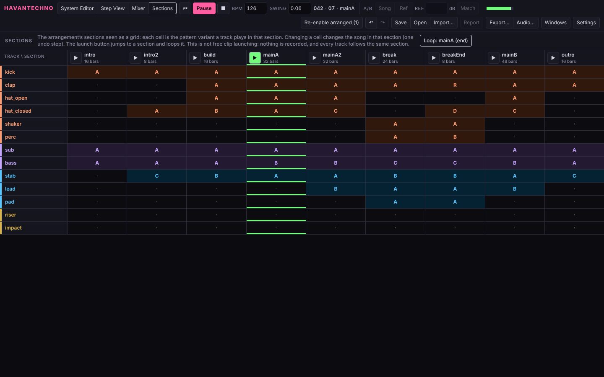 | 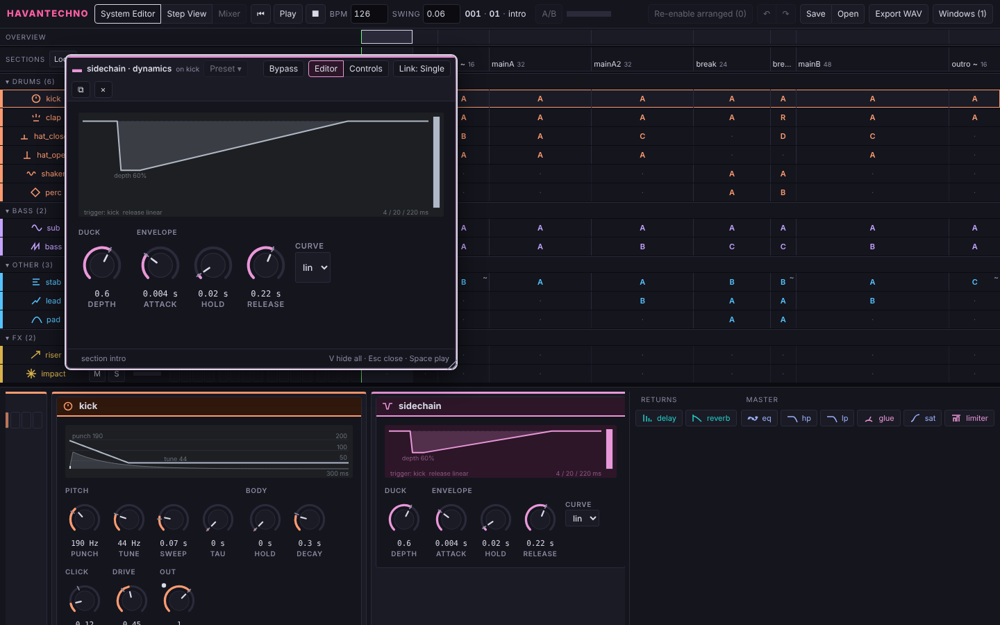 |

### Import and A/B

**Import…** takes an audio file (and its stems, if you have them). The app analyses each part and writes a report:
whether a sound looks like a synth or a sample, mono or poly, FM or subtractive, an 808 or a 909, how much reverb, and
which of its own instruments it suggests. These are guesses with confidence levels, tested on the app's own renders
only. In the desktop app the file can be split into stems first (this needs Python 3 and the separation packages; the
app's message names what is missing). The imported song stays on a **reference lane**; **Ref** switches between it and
the recreation, and **Match** sets the two to the same loudness before you compare.

| | |
|---|---|
| 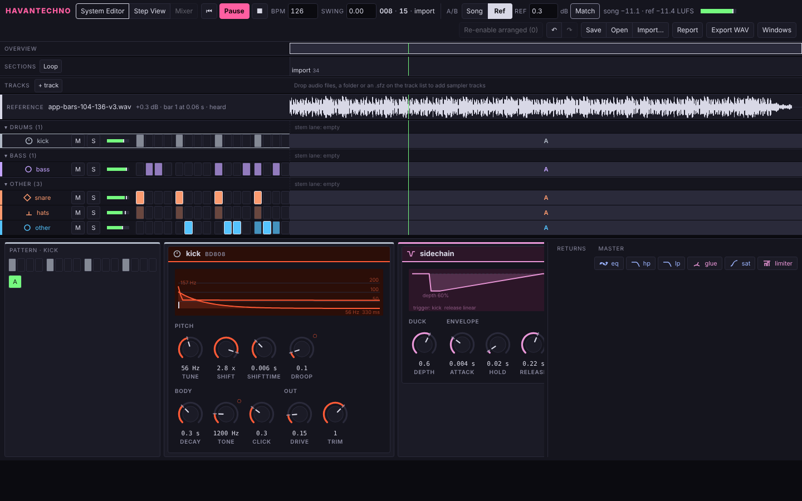 | 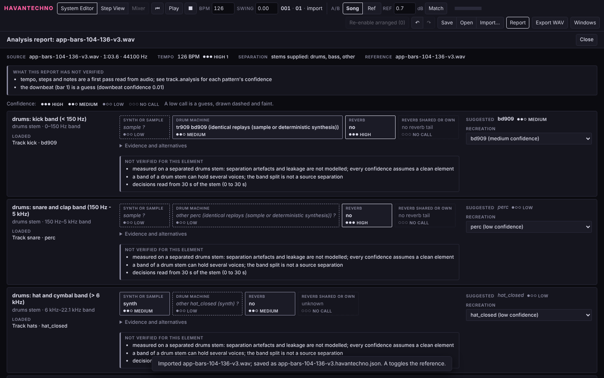 |

**Audio…** adds an audio file as an audio track: its clip sits on the arrangement and plays with the song. Clips are
not time-stretched: a clip whose tempo differs from the song's drifts away from the grid.

### Export

**Export…** writes WAV files: the mix, one file per track (stems), or chosen tracks; the whole song, one section or a
range of bars; 16-bit (with dither), 24-bit (the default) or 32-bit float; any sample rate. Every file of one export has
the same length and starts at the same bar, so stems line up. The dialog lists each file with its length, peak and
loudness (LUFS). Measured by the builder (V1) in Chromium: the stems summed differ from the mix by at most 6.2e-6 (about -104 dB)
with the master chain off; the files' lengths were exact at 44.1, 48 and 96 kHz.

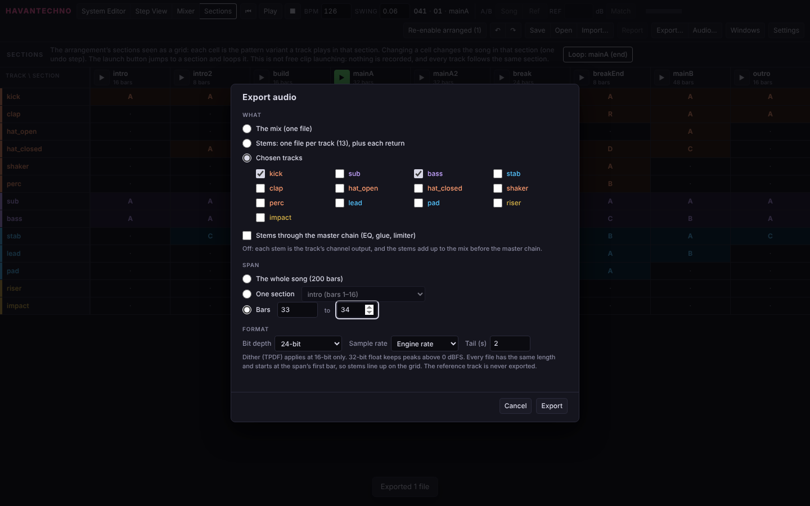

### Presets and patterns

Each instrument window has a **Preset ▾** menu: factory patches (original, written for this project), your own saved
patches, and for the drum machines whole kits; a second group holds **patterns**. Save as, rename, delete, and import or
export as a small text file. On the single pages the same menus are in the bar ("Kits & patterns" on the drum machines);
because those pages cannot start downloads, they offer "Copy as text" and "Paste text" instead. Presets are stored in
the browser (or, in the desktop app, in the app's data folder).

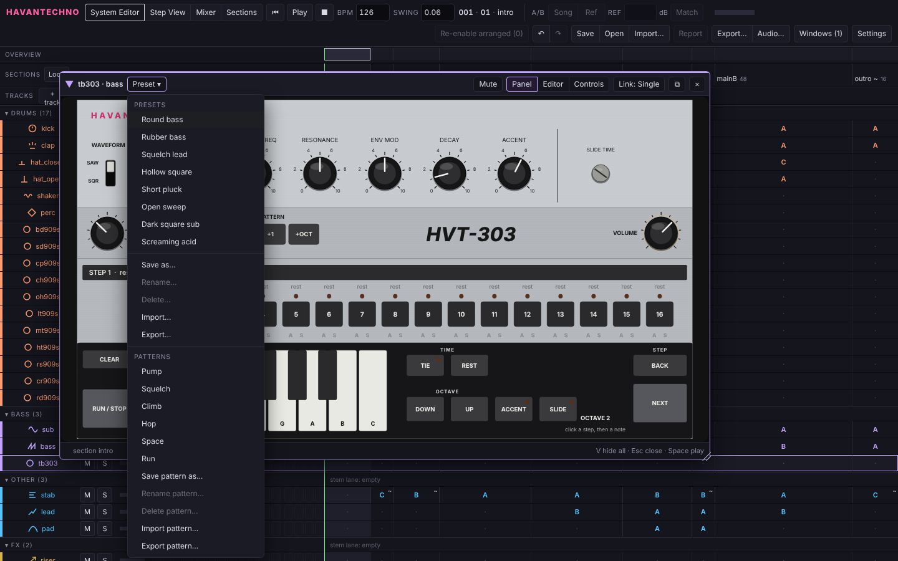

### Settings

**Settings** (Ctrl/Cmd+comma) has three tabs. **Audio**: output device, sample rate, latency, what the engine reports,
a test tone, and export defaults. A web page cannot set the sound card's buffer size, so there is no such control.
**View**: the view to open at start, density, zoom, meter fall-off and peak hold, and whether device windows open on
the panel or the controls. **About**: version and licence.

| | |
|---|---|
| 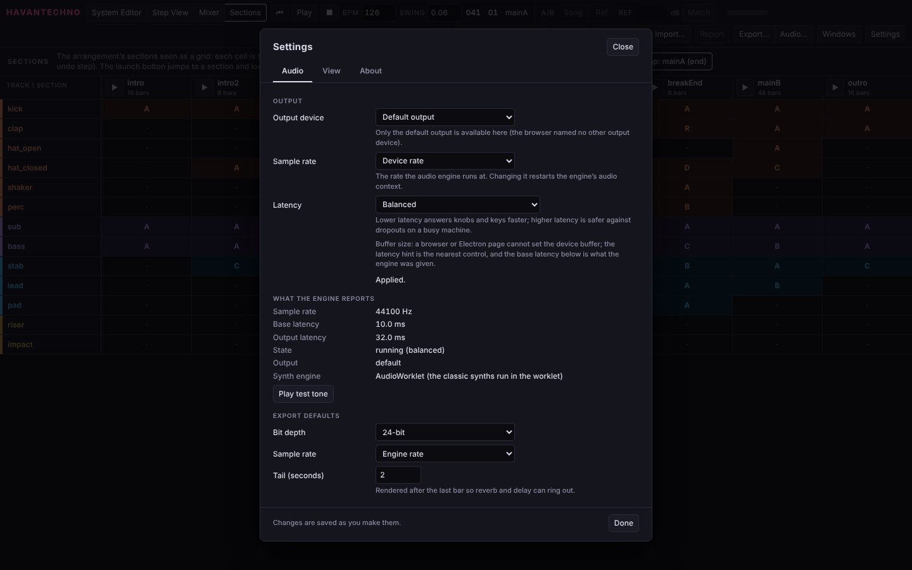 | 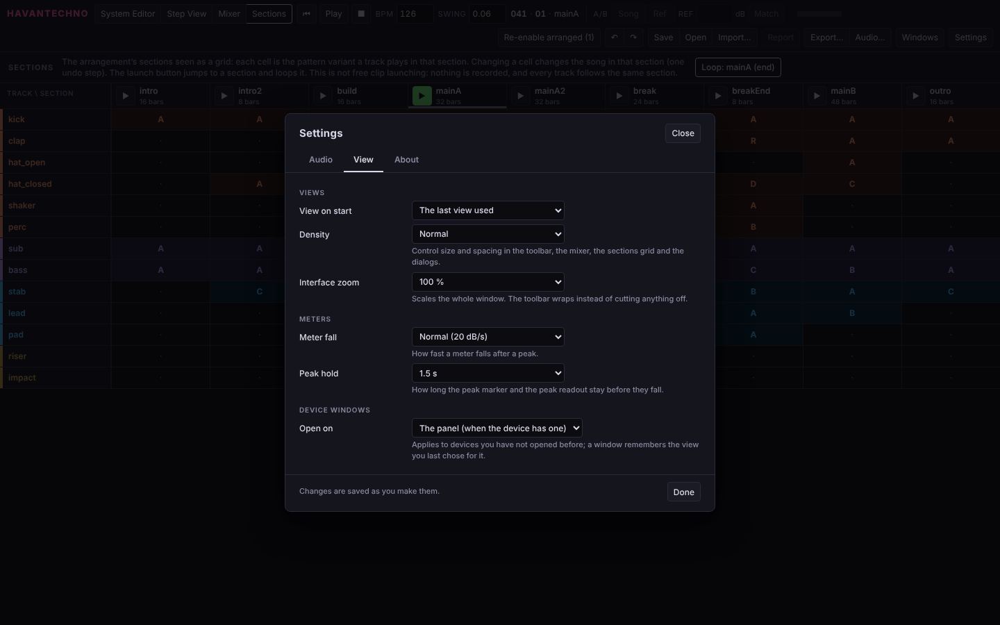 |

## Desktop builds

`docs/BUILD.md` explains how to install and build the desktop app. A workflow (`.github/workflows/build.yml`) builds
installers for macOS (Apple chip and Intel), Windows and Linux and puts them on a draft release; its first run waits for
the owner's go. The installers are not signed, so macOS and Windows warn on first launch; BUILD.md gives the steps past
the warning. **Only the Linux build has been built and started** (in this project's Linux sandbox). The macOS and
Windows builds, and the workflow itself, are untested.

## The instruments and what is known about them

| Instrument | What it is | What has been checked |
|---|---|---|
| HVT-808, HVT-909 | 27 synthesized drum voices (16 for the 808, 11 for the 909) | Scored against numbers in the service manuals: 86 rows pass, 19 fail (`node tools/drums-score.js`). Not compared with a real machine. |
| HVT-909 (sampled) | The 909's voices played from recordings of a real 909 (the Rob Roy set) | The recording a knob setting picks, and peak levels matched to the synthesized kit, measured in Chromium (K1). Not listened to. |
| HVT-909 (ROM) | The 909's hats and cymbals played from images of its own sample chips | The decoding was settled from the owner's chip images (E1); measured against the Rob Roy recordings, the ROM hats are about 0.4 octave darker. Not listened to. |
| HVT-303 | Bass line synth, AudioWorklet; the voice is ported from Open303 | Its cutoff, oscillator and envelope traced by `tools/tb303-bench.js`. Not compared with a real unit. |
| HVT-D | Three-oscillator mono synth, AudioWorklet | The knob laws follow CA-72, a modern recreation of the Model D, not an original unit. |
| HVT-106 | Six-voice poly synth with a bucket-brigade chorus, AudioWorklet | Chorus stereo spread and cost measured (`tools/juno-bench.js`); a little hiss by default (about 59 dB below one voice). Not compared with a real unit. |
| Sampler | Plays audio files and multi-sample programs (SFZ import and export) | Mapping, layers and loops checked in code; no real library has been loaded and listened to. |

### The HVT-909's three voice sources

The 909 panel (on its page and in the app's window) has a switch at the top: **SYNTH**, **SAMPLE** and **ROM**. Under
it the panel says which source the drums and the hats and cymbals are using, and which ROM chips are present.

- **SYNTH**: the synthesized voices. Always available.
- **SAMPLE**: every 909 voice plays the matching recording from Rob Roy Recordings' free TR-909 sample set (1995),
  which is in this repository at `app/assets/tr909-robroy/`. Each knob picks the nearest of the recorded settings
  (for most knobs 0, 3, 7 and 10), so it moves in steps. The set's own terms: it may be copied and shared freely, it
  must not be changed, and it may not be distributed for profit. It is therefore not covered by this project's licence,
  and a commercial release must leave that folder out.
- **ROM**: the closed and open hat, crash and ride, which the real machine plays from three sample chips, play from
  images of those chips. The images are not in this repository. **LOAD ROM…** (or tapping ROM when none are loaded)
  opens a file picker for the three chip files (`hn61256p__c42.ic62`, `__c43.ic69`, `__c44.ic54`, 32 KB each). Each
  file is checked by checksum: a matching file is loaded and marked "verified", anything else is refused with the
  reason. The files are read inside the page and never uploaded.

Each switch is one step of Undo. When a page's copy carries the samples or the chip images, the page loads them at
start and begins on the most real source it has for each voice (ROM for the hats and cymbals, the recordings for the
rest); SYNTH stays one tap away. The owner's chip images are kept outside the repository until it is made private.

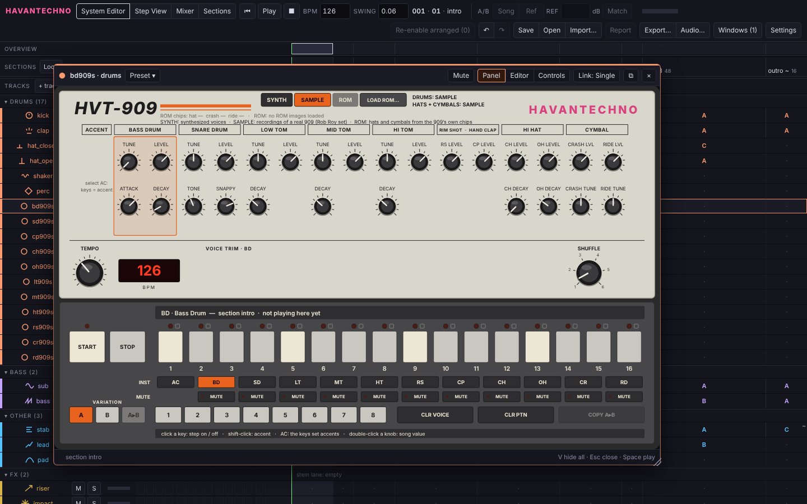

## Checks, for developers

Run each command from the repository folder and read its exit code (0 is a pass); piping into `tail` hides it.

- `node app/engine/selfcheck.js`: the engine, the Host and the project file in Node.
- `node tools/browser-check.js`: opens the app in headless Chromium, starts audio, plays, opens a window, saves, and fails on any page error or missing file.
- One Node check per module in `tools/*-check.js` (panels, solo pages, presets, views, System Editor, drums, sampled 909, export, shell and others). To run them all: `for c in app/engine/selfcheck.js tools/*-check.js; do node "$c" || echo "FAILED: $c"; done`.
- `node tools/drums-score.js` scores the drum voices against the manuals and exits 1 while any row fails (19 do).
- `node tools/solo-bundle.js --all --test` turns each instrument page into a publishable bundle and plays it in headless Chromium. The 909 page looks for its sample set and an asset manifest; give them to its bundle with `--asset-dir assets/tr909-robroy=app/assets/tr909-robroy --write-file 'assets/manifest.json={"tr909-rom":false,"tr909-robroy":true}'`.

`app/README.md` describes the code for developers; `app/CONTRACT.md` is the contract between the modules.

## Repository layout

```
app/                           the program: engine/, ui/, analysis/, solo/ (the instrument pages), shell/ (Electron), assets/
app/assets/tr909-robroy/       the Rob Roy TR-909 sample set, under its own terms (never modified)
app/assets/manifest.json       which optional sound sets this copy carries
tools/                         serve.js, the checks, the bundler for the instrument pages, render and scoring tools
docs/BUILD.md                  installing and building the desktop app
docs/screenshots/              screenshots used in this README
docs/research/                 Roundtable research: briefs, transcripts, discussion, votes, reports
docs/plans/                    the build plan, the roadmap and the strategy
prd.md                         what the product should do (sections 4b to 4e) and the decisions taken (6b)
memory.md                      the project's working memory: read its "Now" section first
future.md                      open items and ideas
olde Havantechno dub studio/   the first studio, archived as it was on 2026-10-23
LICENSE, THIRD_PARTY.md        AGPL-3.0-or-later, and everything that comes from elsewhere
CLAUDE.md                      guidance for coding agents working in this repository
local/                         not in the repository (git-ignored): the owner's own files, such as the 909 chip images
```

The archived first studio is a separate page: with the server running, open
<http://localhost:8000/olde%20Havantechno%20dub%20studio/>. It recreates one Guidance-style electro track with Web Audio
and no audio files; its design notes are in `docs/superpowers/specs/2026-10-21-guidance-studio-design.md`.

## Roundtable: how the work is done

Roundtable is how questions are researched and built here: a group of agents (a **crew**) works in parallel, each
writes everything to a transcript, and a coordinator checks the work before it is committed. The whole company of
agents is **the Soundsystem**. Everything is in `docs/research/`, with a README that lists the crews:

| Crew | What it did |
|---|---|
| Gear Crew | What gear could recreate a track, and what runs in a browser |
| Faceplate | The app's layout; its winning design became the System Editor |
| Build Crew | Built the first version of `app/` to one contract |
| Ear Crew | Measured the recreation against the owner's recording |
| Crate Crew | Chose minimal records to recreate next |
| Box Crew | The sampler and the 27 drum voices |
| Lab Crew | The analysis that guesses what made each sound |
| Patch Crew | The three classic synths and the hardware-style panels |
| Dubplate Crew | Import, analysis report, reference lane and A/B |
| Stem Crew | Research on separation and detection |
| Circuit Crew | Research on the instruments' circuits and the best emulations |
| Showroom Crew | The instrument pages, the presets engine and the bundler |
| Pressing Crew | Version 0.2: export, audio tracks, views, settings, desktop builds, the sampled and ROM 909 |

## Licence

Havantechno is licensed under the GNU Affero General Public License, version 3 or later (`LICENSE`). Some material is
not under that licence, or came from elsewhere; `THIRD_PARTY.md` lists each piece. In short:

- **The Rob Roy TR-909 sample set** (`app/assets/tr909-robroy/`): its own terms (free to copy, not to be changed, not for profit). Leave it out of any commercial release.
- **Ported code**: the HVT-303's voice from Open303 (MIT), the HVT-D's filter from ImprovedMoog (ISC), the HVT-106's chorus constants from BBDDelay (BSD-3-Clause). Their notices are in the source files.
- **Values read from other projects and papers**: andremichelle/tr-909 (AGPL), CA-72 and Junox (GPL-3.0), Juno60 (MIT), the TR-808 papers by Werner and others (CC BY).
- **Separation models** that `tools/separate.py` downloads when it runs (Demucs code MIT, MDX-Net weights CC BY 4.0); models with non-commercial terms are optional downloads.
- **Roland's documents and chip images** are not in this repository. Panels carry Havantechno's mark and model names only.
