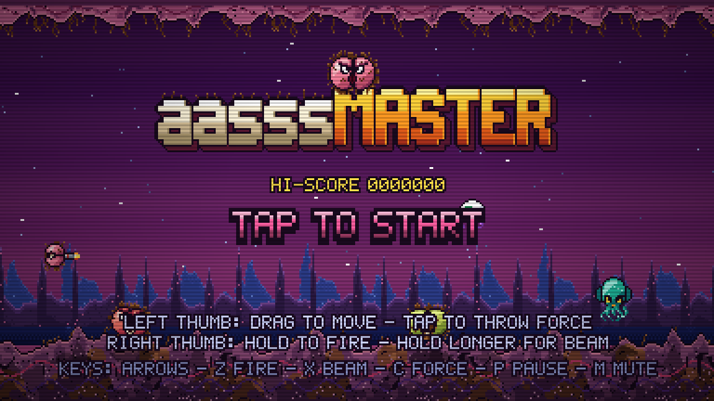

# Havantechno studio

- **The Havantechno studio**, a Web Audio page that recreates a Guidance-style electro track (126 BPM, key B) one element
  at a time, with a sequencer, a processor rack and WAV export.



## Quick start

Serve the folder over HTTP. The studio was tested this way; opening the HTML files straight from disk was not tested.

```bash
python3 -m http.server 8000
```

- Game: <http://localhost:8000/>
- Studio: <http://localhost:8000/studio/>. Press **Play**, then click a section to jump to it.
- Studio self-check, no browser needed: `node studio/selfcheck.js`

## The game

Stages 1 to 3 each end in a boss, and stages 2 and 3 have a mid-boss part way through. After stage 3 the run loops with
higher boss HP and loop modifiers.

| Stage | Name | Length | Boss |
|-------|------|--------|------|
| 1 | HAIRY NEBULA | 60 s | `boss_butt` |
| 2 | THE CRACK OF DOOM | 70 s | `boss_crack` (mid-boss at 40 s) |
| 3 | RECTUM OF THE GODS | 80 s | `boss_god` (mid-boss at 45 s) |


### Controls

| Action | Keyboard | Touch |
|--------|----------|-------|
| Move | Arrows or WASD | Drag on the left side. The ship follows the finger, not an absolute position. |
| Fire | Z, Space or Ctrl (hold) | Hold on the right side |
| Charged beam | Hold X | Hold longer on the right side |
| Force pod | C or Shift (toggle) | Tap on the left side to throw the Force |
| Bomb | B | |
| Pause | P or Esc | |
| Mute | M | |
| Haptics | V | |

### Components

| File | What it does |
|------|--------------|
| `index.html` | The page shell. Loads the scripts in order and sizes the canvas. |
| `js/sprites.js` | Global `Sprites`. Builds every sprite from character grids at load, plus a small pixel font. |
| `js/sfx.js` | Global `SFX`. Synthesises sound effects and the chiptune tracks for the title, the stages, mid-bosses, bosses and game over. |
| `js/levels.js` | Global `Levels`. Pure data: ten regular enemy types, one mid-boss and three bosses, wave scripts, boss phases, loop modifiers, power-up drops, and `validate()`. |
| `js/render.js` | Global `GameRender`. Everything drawn to the canvas: backdrop, raster effects, HUD, banners and the title, continue and game-over screens. |
| `js/game.js` | Global `Game`. The engine: the loop, input, collision, weapons, the Force pod, bosses, scoring, checkpoints and the debug hooks. |

Debug hooks on `Game` (`info()`, `skipTo(stage, t)`, `skipToBoss()`, `give(power, force, shield)`, `step(n)`) make it
possible to reach any point in a run from the console.

## The studio


Each strip is one synth from the sequencer, with its level, pan, sends, duck depth and synth parameters. The processor
rack at the bottom holds the send effects and the master chain.


### Components

| File | What it does |
|------|--------------|
| `studio/index.html` | The studio page: transport, sections, the track strips, the processor rack and the export buttons. |
| `studio/core.js` | Global `Kit`. Shared helpers: AudioParam scheduling (`setV`, `lin`, `expo`, `target`), note and chord parsing, the noise buffer, impulse responses, and `defineParams`, which builds sliders from spec objects. |
| `studio/synths.js` | Global `Synths`. Thirteen instruments: kick, sub, bass, stab, clap, closed and open hats, shaker, perc, lead, pad, riser and impact. Each instrument has `trigger`, `set`/`get`, `panic` and `dispose`. |
| `studio/processors.js` | Global `Processors`. Ten processors: filter, saturator, delay, reverb, eq3, compressor, limiter, sidechain ducker, widener and chorus. Also `chain`, `channel` (a track's strip) and `master` (the master chain). |
| `studio/sequencer.js` | Global `Sequencer`. The transport, the 16-step scheduler with swing, pattern and melody notation, the arrangement, mixer state, the parameter paths, and offline rendering to WAV. |
| `studio/song.js` | Global `Song`. The track's patterns, chords, lead melody and the nine-section, 200-bar arrangement. Edit the track here. |
| `studio/studio.js` | Page logic only: builds the strips and the rack from the spec, wires the controls, and runs the WAV export. |
| `studio/selfcheck.js` | A Node smoke test with a fake AudioContext. Checks that every module loads, the song schedules all 200 bars, ducking fires, parameters clamp, and the WAV encoder works. |

The sound design decisions, the analysis of the reference track and the tuning notes are in
[`docs/superpowers/specs/2026-10-21-guidance-studio-design.md`](docs/superpowers/specs/2026-10-21-guidance-studio-design.md).

## Repo layout

```
index.html, js/      the game
studio/              the studio
docs/                design notes, specs and screenshots
team/                the four-role design discussion behind the game's v2 rewrite
CONTRACT.md          the module contract between the game's files
prd.md               product requirements for both projects
future.md            open items and ideas
memory.md            timestamped summaries of the working state
context.md           timestamped context dump from the earlier session
CLAUDE.md            guidance for coding agents working in this repo
```

## Everything is generated

There are no image, audio or font files in this project. All the pixel art is built in code, all the sounds and music
are synthesised in the browser, and the levels are plain data. Clone it, change a number in `js/levels.js` or a pattern
in `studio/song.js`, and reload. `Levels.validate()` logs a warning to the console when a change breaks a stage.
