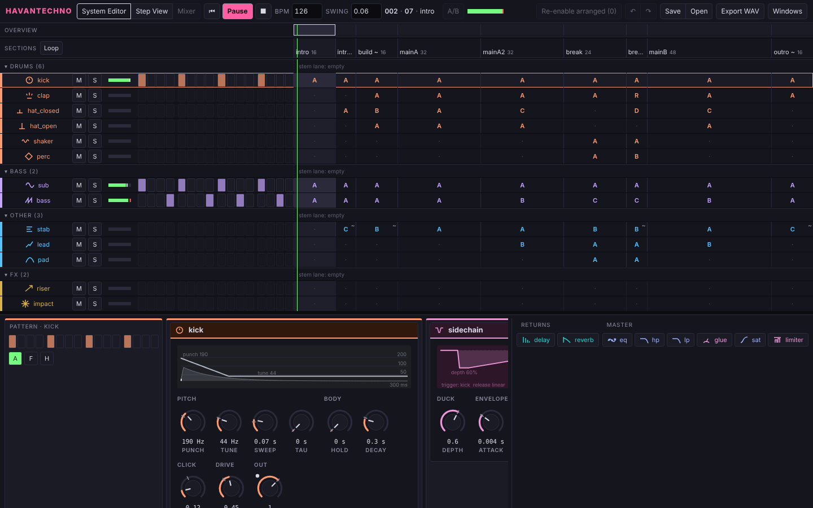
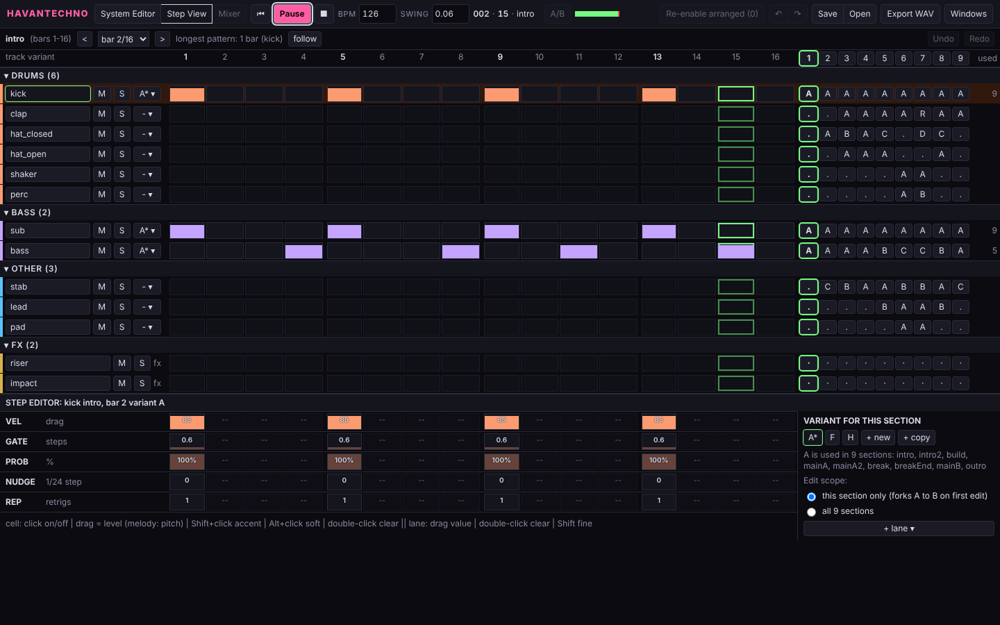
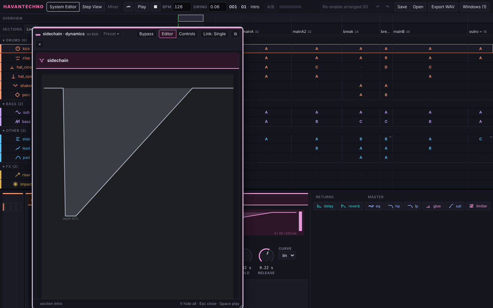
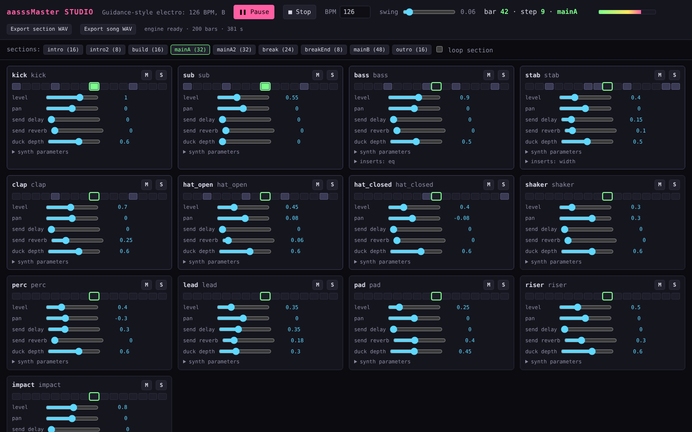
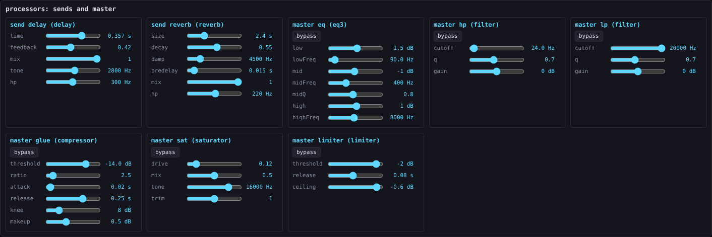

# Havantechno

Havantechno is becoming a remixing DAW for Mac and PC: take a source song, separate it into stems, turn the stems
into MIDI and parameters, and recreate the song with synths and processors that live in the app, or with hosted
plugins. Today the repo holds the first step: a Web Audio studio that recreates one Guidance-style electro track
(126 BPM) one element at a time, with one synth per element, a 16-step sequencer, a 200-bar arrangement, a
processor rack and WAV export. It runs in a browser with no audio files.

The next version lives in `app/` and runs both in a browser and as an Electron desktop app. Its first build (the
Build Crew's wave 1, 2026-10-23) has the three faces the research voted for: the **System Editor** (a section ruler,
compact track rows, and the selected track's device chain), the **Step View** (the same shape, with every step of
every track editable: velocity, accent, length, nudge, probability, condition, repeats and parameter locks), and
**floating windows per device**, each with its own face. It edits the Guidance recreation as a song document, saves
and reopens it, and exports WAV. See `app/README.md` for how to run it and what is verified.

The studio as first built is archived unchanged in `olde Havantechno dub studio/`. The design came out of the
research in `docs/research/` (see **Roundtable** below).







The archived studio, for comparison:



## Quick start

Serve the folder over HTTP, then open the studio:

```bash
python3 -m http.server 8000
```

- Studio: <http://localhost:8000/olde%20Havantechno%20dub%20studio/>. Press **Play**, then click a section to jump to it.
- Self-check, no browser needed: `node "olde Havantechno dub studio/selfcheck.js"`

The new app needs COOP/COEP headers, so it has its own server:

```bash
node tools/serve.js            # then open http://localhost:8000/app/
cd app && npm install && npm start   # the Electron desktop app
node app/engine/selfcheck.js   # engine self-check, 263 checks
node tools/browser-check.js    # opens the app in headless Chromium, 26 checks
```

Each strip is one synth from the sequencer, with its level, pan, sends, duck depth and synth parameters. Tweak any of
them while the track plays. The processor rack at the bottom holds the send effects and the master chain.



## Arrangement

The track runs through nine sections for 200 bars in total: intro (16), intro2 (8), build (16), mainA (32), mainA2 (32),
break (24), breakEnd (8), mainB (48) and outro (16). Click a section to jump to it, or tick **loop section** to stay in it.

## Components

| File | What it does |
|------|--------------|
| `olde Havantechno dub studio/index.html` | The studio page: transport, sections, the track strips, the processor rack and the export buttons. |
| `olde Havantechno dub studio/core.js` | Global `Kit`. Shared helpers: AudioParam scheduling (`setV`, `lin`, `expo`, `target`), note and chord parsing, the noise buffer, impulse responses, and `defineParams`, which builds sliders from spec objects. |
| `olde Havantechno dub studio/synths.js` | Global `Synths`. Thirteen instruments: kick, sub, bass, stab, clap, closed and open hats, shaker, perc, lead, pad, riser and impact. Each instrument has `trigger`, `set`/`get`, `panic` and `dispose`. |
| `olde Havantechno dub studio/processors.js` | Global `Processors`. Ten processors: filter, saturator, delay, reverb, eq3, compressor, limiter, sidechain ducker, widener and chorus. Also `chain`, `channel` (a track's strip) and `master` (the master chain). |
| `olde Havantechno dub studio/sequencer.js` | Global `Sequencer`. The transport, the 16-step scheduler with swing, pattern and melody notation, the arrangement, mixer state, the parameter paths, and offline rendering to WAV. |
| `olde Havantechno dub studio/song.js` | Global `Song`. The track's patterns, chords, lead melody and the nine-section, 200-bar arrangement. Edit the track here. |
| `olde Havantechno dub studio/studio.js` | Page logic only: builds the strips and the rack from the spec, wires the controls, and runs the WAV export. |
| `olde Havantechno dub studio/selfcheck.js` | A Node smoke test with a fake AudioContext. Checks that every module loads, the song schedules all 200 bars, ducking fires, parameters clamp, and the WAV encoder works. |

The sound design decisions, the analysis of the reference track and the tuning notes are in
[`docs/superpowers/specs/2026-10-21-guidance-studio-design.md`](docs/superpowers/specs/2026-10-21-guidance-studio-design.md).

## Roundtable: the research behind the next version

Roundtable is how design questions are researched here: a team of agents on several models researches in parallel,
writes every finding to a transcript, reads each other's work, argues in writing and votes. Everything is in
`docs/research/`, with a README that explains the process and lists the groups:

| Group | Question | Result |
|-------|----------|--------|
| Gear Crew | What gear could recreate a source track, and what runs where? | `docs/research/2026-10-23-plugin-gear/REPORT.md`. The reference was re-measured and parts of the original spec overturned; a gear list by licence; a 15-step build order; an Electron-first desktop recommendation. |
| Faceplate | How should the DAW be laid out, and how does each device get its own look? Ableton Live and Logic Pro as references. | `docs/research/2026-10-23-faceplate-layout/REPORT.md`. Strip Bench won the vote and became the System Editor; a round-5 follow-up covers floating windows, the Step View and the desktop shell. Mockups: https://claude.ai/artifact/Wy3gZLnLoShp6uzxrNVfP7 (private until shared). |
| Build Crew | Build it: ten agents coding to one contract (`app/CONTRACT.md`), talking through the coordinator, each verifying its own module. | `docs/research/2026-10-23-build-crew/`: brief, one log per agent, the coordinator's log, `DISCUSSION.md` (the compiled conversation) and, after wave 2, `REPORT.md`. Wave 1 shipped `app/` with every check green; wave 2 (integration review, fixes, the sampler) is running. |

Each group's folder holds its brief, every agent's transcript per round, and the report; Faceplate also has
`DISCUSSION.md` and `VOTE.md`. The transcripts state their own verification limits: page fetches often failed from
the research sandbox, so many product facts rest on search excerpts and are marked that way. The numbers about the
reference track come from numpy measurements with the method stated per row.

## Repo layout

```
app/                           the DAW: engine, UI, Electron shell; app/README.md and app/CONTRACT.md
tools/                         serve.js (COOP/COEP), browser-check.js, render.js and score.py, per-module checks
olde Havantechno dub studio/   the studio, archived as it was on 2026-10-23
docs/screenshots/              screenshots used in this README
docs/superpowers/specs/        the studio design spec and the analysis of the reference track
docs/research/                 Roundtable research: briefs, transcripts, discussion, votes, reports
prd.md                         product requirements, with the remix-DAW direction in section 4b
docs/plans/                    the desktop build plan, milestones 1 to 6
LICENSE, THIRD_PARTY.md        AGPL-3.0-or-later, and the list of ported code
future.md                      open items and ideas
context history.md             timestamped context dumps, written every 7 to 8 updates
memory.md, context.md          earlier timestamped dumps
CLAUDE.md                      guidance for coding agents working in this repo
```

## Working practices

- Context dumps go to `context history.md` with a UTC stamp every 7 to 8 updates; the window is then compacted.
- Commits carry a generic Claude co-author line and the session trailer, never a model name.
- No history rewrites or force-pushes without the owner's say-so.
